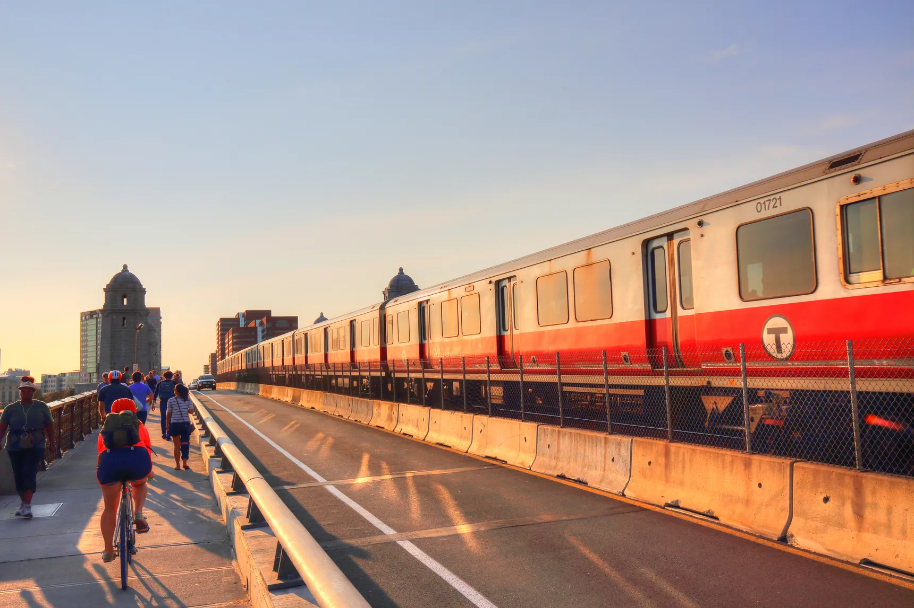
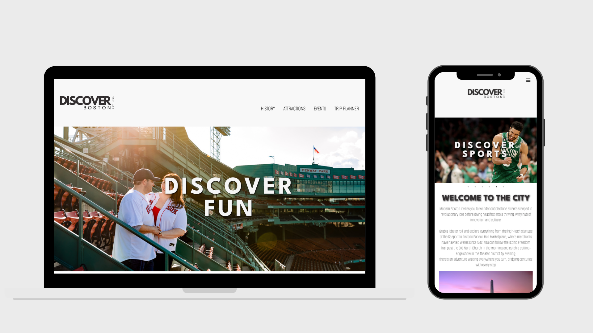
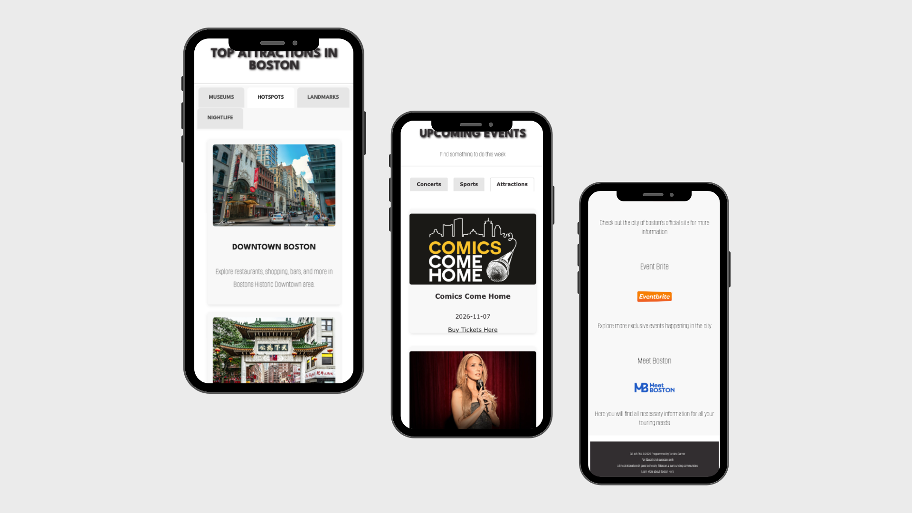
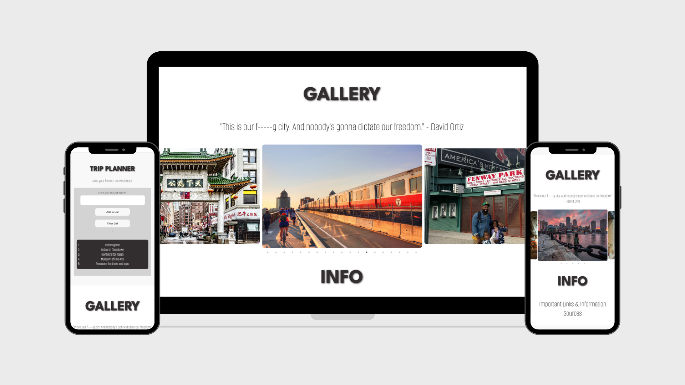
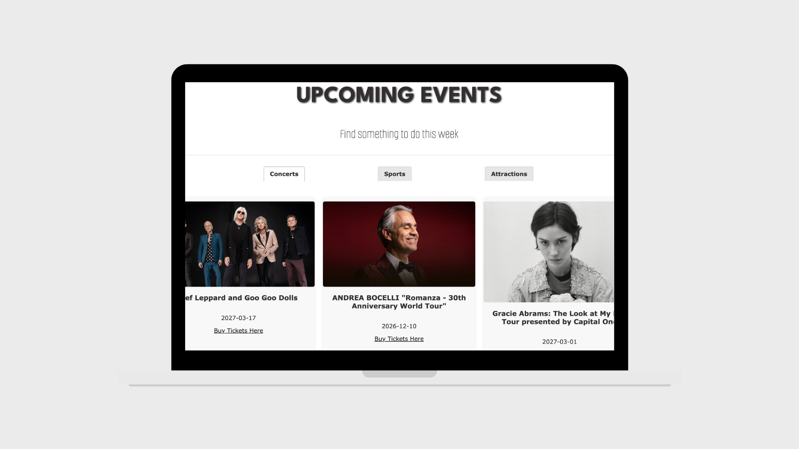

# FINAL PROJECT DISCOVER BOSTON

<h3>From My Home To Yours</h3>

<h3>⭐️ About the Project</h3>

Discover Boston is a single-page travel and tourism website developed to showcase Boston, Massachusetts, as a destination for visitors and locals.
The goal was to create an interactive city guide for travelers to come to, to showcase popular attractions, historical landmarks, nightlife, local events and photography. 

Visitors can explore different areas of the city, discover things to do and find upcoming events in an organized and visually engaging way.
The website was developed as a front-end web development project, emphasizing responsive design, interactive functionality, API integration and visual storytelling.

***

<h3>🍀 Inspiration</h3>

Being originally from Boston, Massachusetts, I wanted to create a project that would showcase the city beyond the typical tourist attractions. I wanted to bring together the many experiences a city has to offer, from museums, landmarks and nightlife to local events, hidden gems and everything in between.

As someone who enjoys traveling, I often find myself searching across multiple websites, platforms and resources just to discover what's available in a particular area. I wanted to create one central place where travelers could explore as many experiences as possible, without having to search in multiple locations.

While this project began with Boston, my vision extends far beyond one city. I wanted to build something that could become a universal travel platform, adaptable to different cities while also maintaining a consistent identity and user experience.

My long-term vision is to develop DISCOVER into a recognizable travel brand, with individual city destinations such as DISCOVER BOSTON, DISCOVER NEW YORK, DISCOVER MIAMI and beyond.

The goal is to create an all-encompassing city guide that helps travelers and locals discover everything a destination has to offer, all in one place.

***

<h3>🚀 Project Features</h3>

  
  - **Interactive Attractions:** Used jQuery UI tabs to allow users to explore Boston's museums, popular hotspots, landmarks and nightlife.
  
  - **Dynamic Event Listings:** Used Ticketmaster API integration to load in and loop through different types of events via categories.

  - **Web Storage Capability:** Used JavaScript to create Web Storage for user to create a list of their plans while visiting Boston. Users have the ability to clear the local storage as well to start                                   a new list. 
  
  - **Photography Gallery:** A collection of Boston photography highlighting the city's architecture, culture and atmosphere.
  
  - **Responsive Design:** Provides an accessible experience across desktop and mobile devices.

***

<h3>🔮 Future Development</h3>

Discover Boston is the starting point for a larger vision - Expanding the DISCOVER brand into a nationwide travel and exploration platform.

**Future development goals:**

  - **Interactive U.S. Map:** Develop a clickable map of the United States where users can select a state or city to explore its own DISCOVER destination page.
  
  - **City-Specific Websites:** Expand the platform with individual destinations such as DISCOVER NEW YORK, DISCOVER MIAMI, DISCOVER LOS ANGELES and more.
  
  - **Reusable Website Structure:** Build a scalable foundation that allows new city destinations to share a consistent layout, features and user experience while maintaining their own unique identity.
  
  - **Expanded Discovery Categories:** Incorporate more ways to explore each destination, including restaurants, outdoor activities, cultural experiences, shopping, local events and hidden gems.
  
  - **Interactive Features:** Explore additional functionality such as personalized recommendations, saved destinations and trip-planning tools.
  
  - **Long-Term Vision:** Transform DISCOVER into a centralized travel resource where users can explore destinations across the United States and eventually beyond.

  
  ***

<h3>🛠️ Tools & Technologies</h3>

| Tool | Purpose | 
| -------- | -------- | 
| HTML5  | Website structure and content | 
| CSS3  | Styling, layouts and responsive design | 
| JavaScript  | Interactive functionality and API requests  | 
| jQuery | DOM Behavior and Interactive Tabs  | 
| jQuery UI | Interactive Tabs and content organization | 
| TicketMaster API  | Discover Events V2 integration  | 

***

<h3>🖌️ Design & Branding</h3>

The brainstorming process consist of creating the logo, color palette and gathering inspiration from the various city life experience in Boston.

***

<h3>💻 Website Preview</h3>

The visual direction of Discover Boston focuses on presenting the city through a combination of photography, organized content and interactive elements.

